<h1 id="modern-flames-cards">
  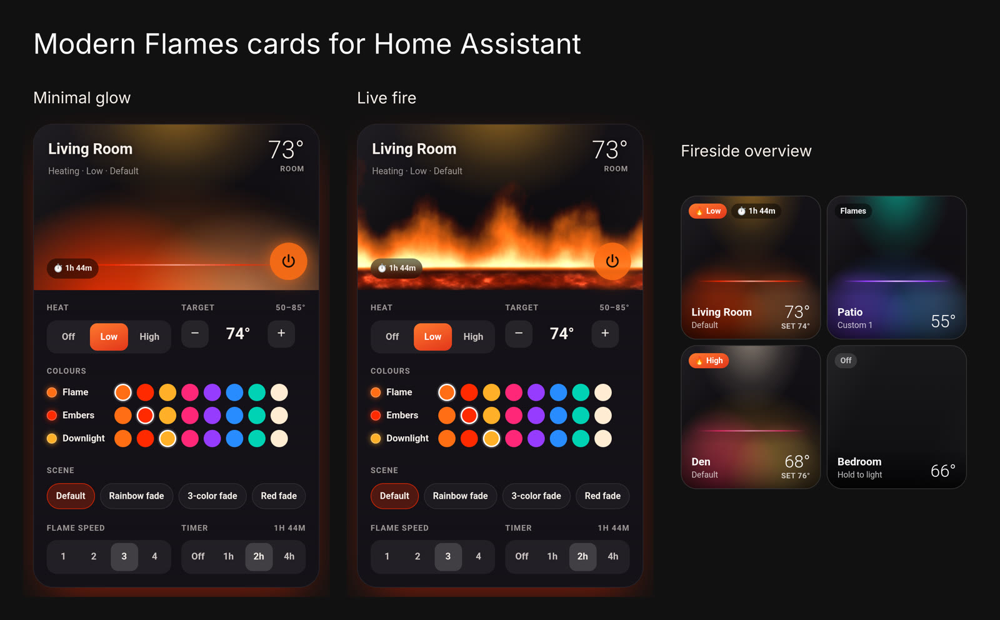
</h1>

Open the dashboard on a cold evening and the fireplace card is already glowing in the same colours as the real flames, embers and downlight. Turn the heat to low, set a two-hour timer, or switch the flames to blue for a party, all from one card. These are Home Assistant dashboard cards for Modern Flames Wi-Fi fireplaces running locally through [tuya-local](https://github.com/make-all/tuya-local).

**[Install](#install)** · [See the cards](#the-cards) · [Make it yours](#make-it-yours) · [Get your fireplace into Home Assistant first](docs/INTEGRATION.md)

## Two looks

| Minimal glow (default) | Live fire |
| --- | --- |
| A soft, slowly drifting gradient in your flame and ember colours, with a thin ember line. No drawn flames. Calm, Apple Home or Nest style, and nearly free on CPU. | A real-time WebGL flame drawn from your flame colour, ember colour and flame speed. Capped at 30 fps, paused when off-screen, and it falls back to the glow on devices without WebGL. |
| `flame_style: glow` | `flame_style: shader` |

<p align="center">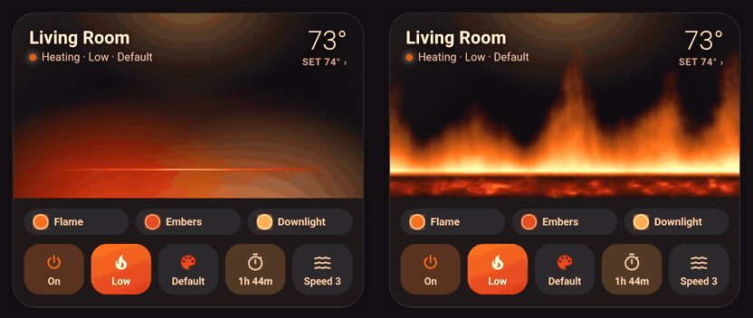</p>

Both looks follow the fireplace live: colours, brightness, fade and jump scenes, and the flame motor speed. When the fireplace is off, the card goes dark.

## What it can do

- **Power and heat.** Turn the fireplace on (flames only) or off, and cycle the heater Off → Low → High. The card shows the room temperature, and the target temperature whenever the heater is running.
- **Colours.** See the flame, ember and downlight colours at a glance. Tap a zone for Home Assistant's colour picker, or pick a swatch on the Studio card.
- **Scenes, speed and timer.** Step through the fireplace's 11 scenes, the 4 flame motor speeds and the off timer. Hold any button for the full Home Assistant dialog.
- **Four layouts.** A hero card, a slim chip row, an overview tile for a grid, and an all-in-one Studio card with a demo mode.
- **Yours to style.** Pick the look, the buttons, the corner radius, a compact size, fixed preview colours and brightness, or switch animation off entirely for slow wall tablets.

## The cards

| Card | What it is | Needs |
| --- | --- | --- |
| **Hearth** | Hero card: big flame preview with name, status and temperature, the three colour zones, then Power, Heat, Scene, Timer and Speed buttons. | button-card |
| **Ember Chips** | One slim pill per fireplace: a tiny glowing orb, name and status, then Power, Heat and Scene. Follows your light or dark theme. | button-card |
| **Fireside Overview** | One tile per fireplace for a grid, with heat and timer badges. Tap for details, hold to turn on or off. | button-card |
| **Studio** | Every control in one card: heat, target stepper, colour swatches, scenes, flame speed and timer. Has a demo mode. | `modern-flames-card.js` only |

| Hearth: glow | Hearth: live fire |
| --- | --- |
| 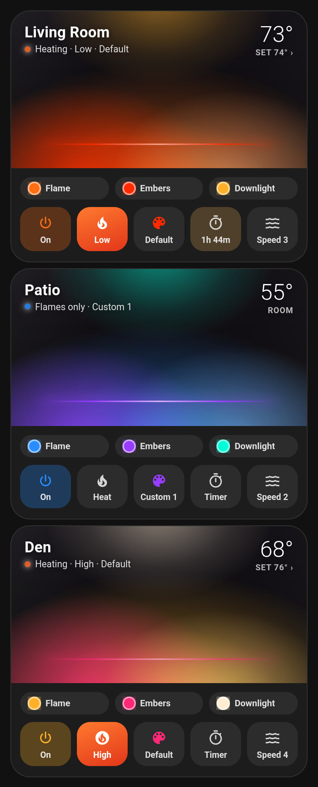 | 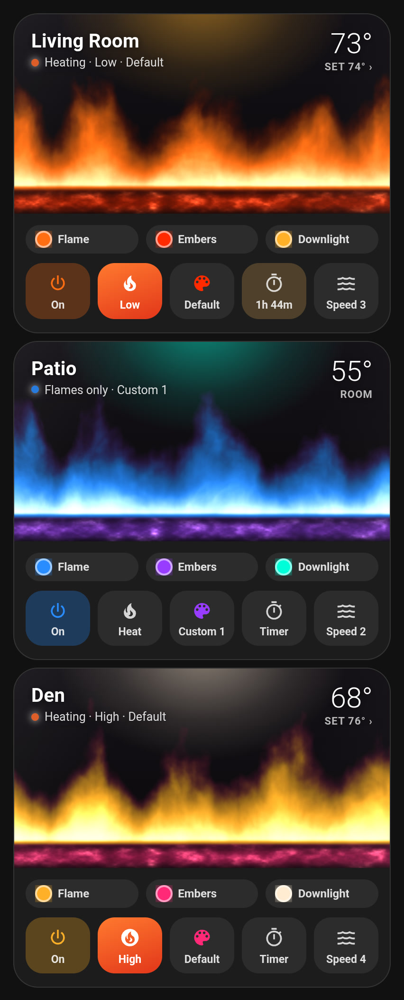 |

| Fireside Overview: glow | Fireside Overview: live fire |
| --- | --- |
| 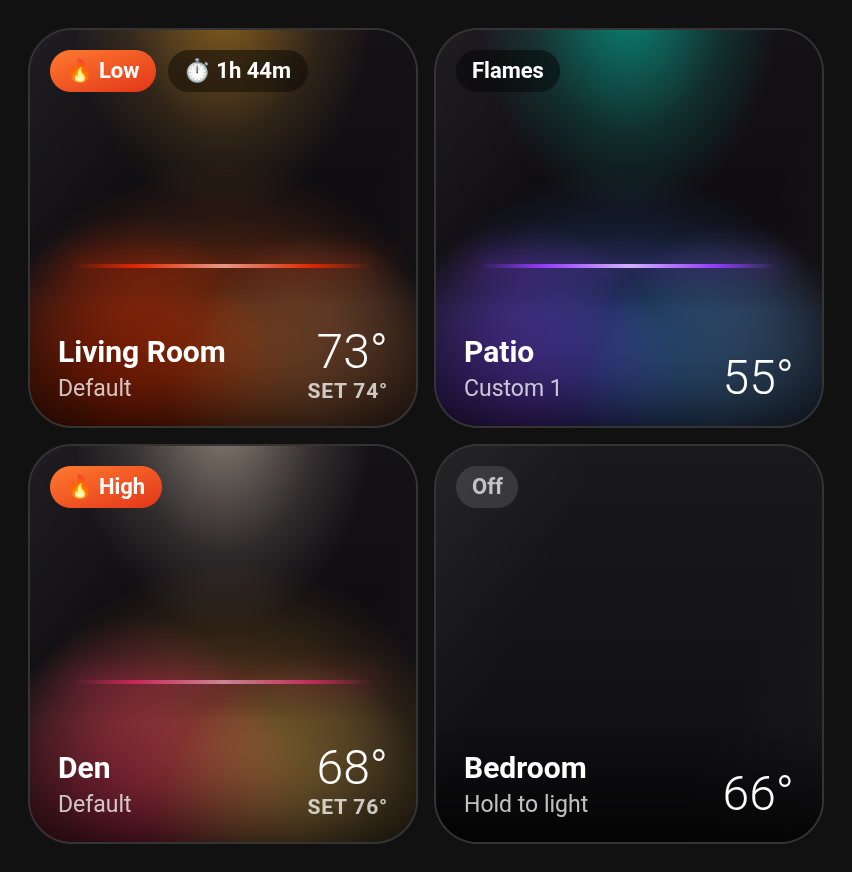 | 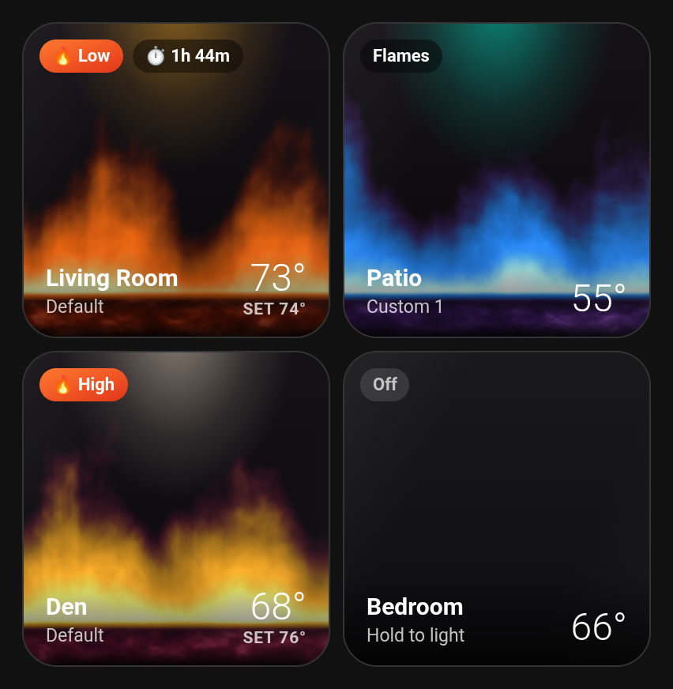 |

| Studio: glow | Studio: live fire |
| --- | --- |
| 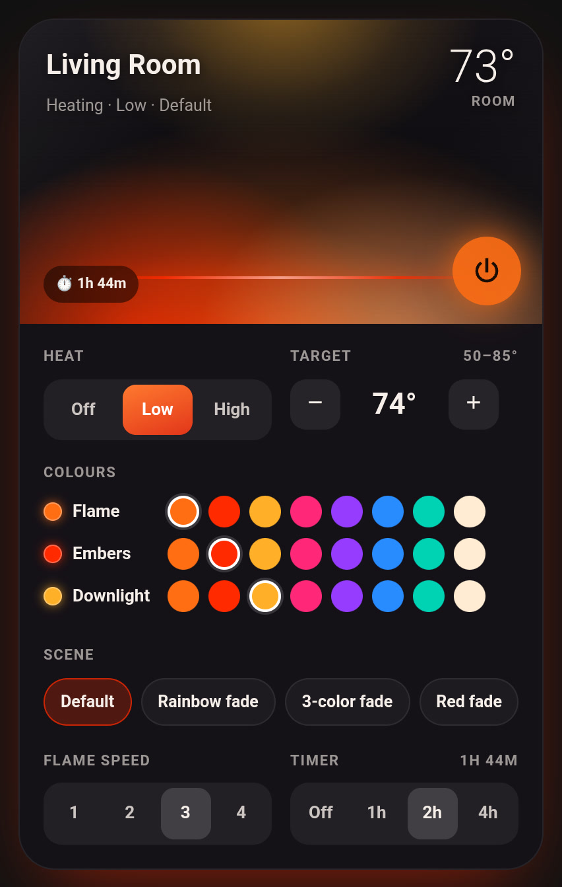 | 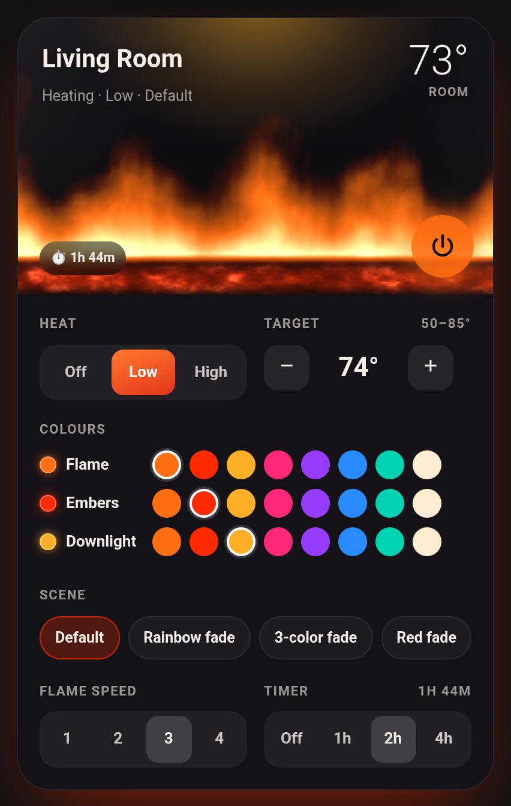 |

<details>
<summary>Ember Chips, customised cards and the illustrated extra</summary>

| Ember Chips (dark and light theme) | Customised |
| --- | --- |
| 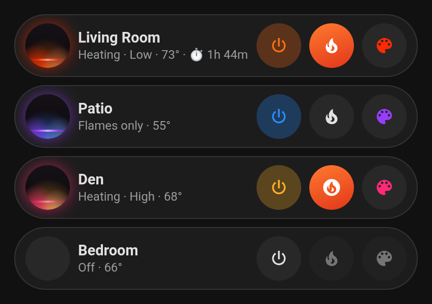<br>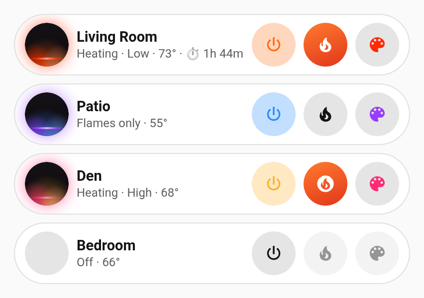 | 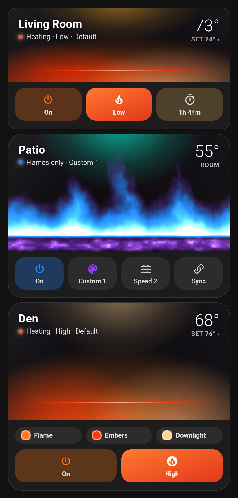<br>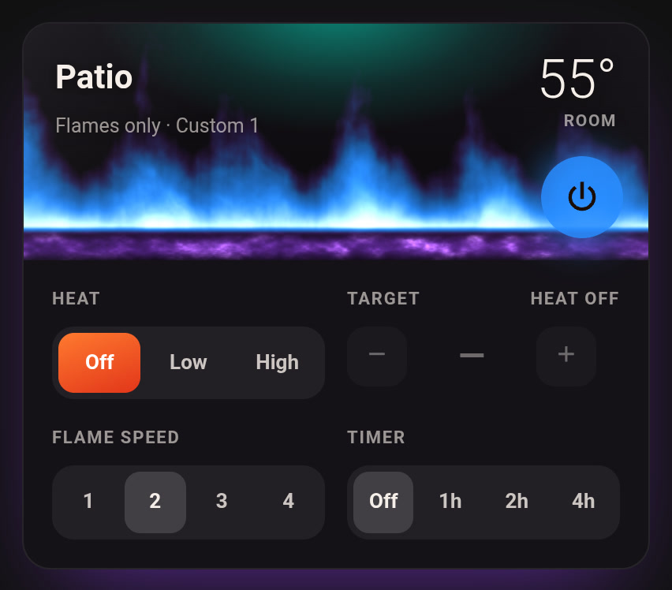 |

**Illustrated** (`flame_style: illustrated`) keeps the earlier hand-drawn SVG flames for anyone who likes them:

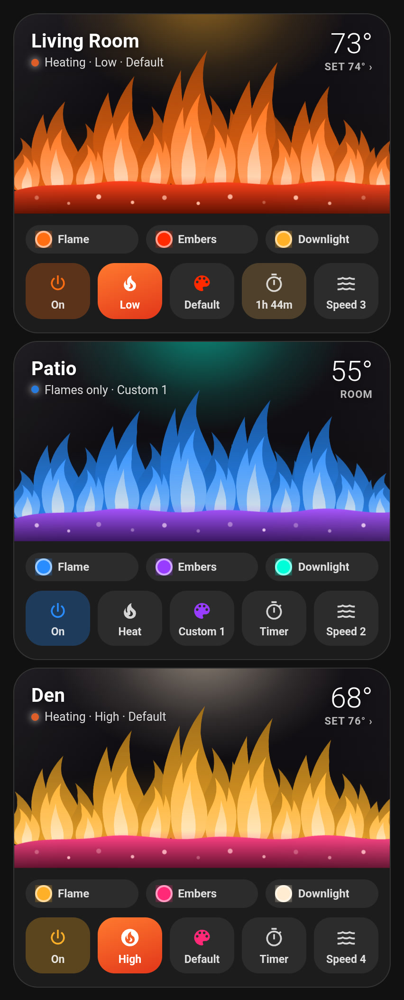

</details>

Every screenshot uses the fake fireplaces in [`demo/`](demo/) on a test install, so nothing real was switched to take them.

## Requirements

[](#requirements)
[](#requirements)
[](LICENSE)

- **A Modern Flames fireplace in Home Assistant** through [tuya-local](https://github.com/make-all/tuya-local), 2026.8.1 or newer, using the *Modern Flames Landscape Pro Slim* device profile. Not there yet? Follow the **[integration guide](docs/INTEGRATION.md)**.
- **Home Assistant** 2026.9 or newer. Tested on 2026.11.2.
- **[button-card](https://github.com/custom-cards/button-card)** from HACS for Hearth, Ember Chips and Fireside Overview. Tested with 7.0.1. Studio needs nothing else.
- **Live fire** needs WebGL, which every current browser and the Companion apps have. Without it the card shows the glow instead.

These were tested in desktop Chrome against demo fireplaces. Phone, tablet and real-hardware testing is still pending.

## Install

### Hearth, Ember Chips and Fireside Overview (button-card templates)

1. Install **button-card** from HACS and refresh your browser.
2. Open your dashboard → ⋮ → **Edit dashboard** → ⋮ → **Raw configuration editor**.
3. Paste everything from [`button-card/modern-flames-templates.yaml`](button-card/modern-flames-templates.yaml) at the top. If you already have a `button_card_templates:` section, paste only the templates under it.
4. Add a card (**Manual**) and set your fireplace's climate entity:

```yaml
type: custom:button-card
template: modern_flames_hearth        # or modern_flames_chips / modern_flames_tile
entity: climate.living_room_fireplace
variables:
  flame_style: shader                 # leave out for the minimal glow
```

Overview grid:

```yaml
type: grid
columns: 2
square: false
cards:
  - type: custom:button-card
    template: modern_flames_tile
    entity: climate.living_room_fireplace
  - type: custom:button-card
    template: modern_flames_tile
    entity: climate.patio_fireplace
```

### Studio card

**Through HACS (custom repository):** HACS → ⋮ → **Custom repositories** → add `https://github.com/jclark2496/modern-flames-ha`, type **Dashboard**. Install **Modern Flames Card** and refresh. HACS adds the resource for you.

**Manually:**

1. Copy [`dist/modern-flames-card.js`](dist/modern-flames-card.js) to `/config/www/modern-flames-card.js`.
2. **Settings → Dashboards → ⋮ → Resources → Add resource**: `/local/modern-flames-card.js`, type **JavaScript module**. Refresh.

Then add the card:

```yaml
type: custom:modern-flames-card
entity: climate.living_room_fireplace
flame_style: glow          # or shader
# demo: true               # try it with no fireplace; nothing is sent to Home Assistant
```

More in [`examples/`](examples/).

## Make it yours

Button-card options go under `variables:`. Studio options go at the top level of the card.

| Option | Cards | Default | What it does |
| --- | --- | --- | --- |
| `flame_style` | all | `glow` | `glow`, `shader` (live fire) or `illustrated` |
| `realistic` | all | `true` | `false` stops all animation and shows a still frame, for low-power wall tablets |
| `intensity` | all | `1` | preview brightness, `0.2`–`1.6`. Only the picture changes, not the fireplace |
| `speed_sync` | all | `true` | `false` runs the preview at a calm fixed pace instead of following the flame motor speed |
| `colors` | all | live colours | fixed preview colours, e.g. `{flame: '#ff6a00', embers: '#ff2a00', downlight: '#ffb028'}` |
| `entities` | all | from the prefix | point at entities with other names: `flame`, `embers`, `downlight`, `scene`, `speed`, `timer`, `remaining`, `sync` |
| `prefix` | all | from the climate entity | the shared entity prefix, e.g. `living_room_fireplace` |
| `title` / `name` | all | friendly name without "Fireplace" | display name (`title` on button-card, `name` on Studio) |
| `radius` | Hearth, Fireside, Studio | `26px` / `22px` / `28px` | corner radius |
| `compact` | Hearth, Fireside, Studio | `false` | shorter flame area. Hearth also drops the colour-zone row; Studio shows heat, target, speed and timer only |
| `controls` | Hearth | `[power, heat, scene, timer, speed]` | which buttons, in order. Any of `power heat scene timer speed sync` |
| `show_zones` | Hearth | `true` | show the Flame / Embers / Downlight row |
| `tile_height` | Fireside | `200px` (`150px` compact) | tile height |
| `show` | Studio | all sections | any of `heat target colors scene speed timer` |
| `demo` | Studio | `false` | runs on fake local state and sends nothing |

**Theme variables.** Set these in your Home Assistant theme to restyle every card at once: `--mf-radius` (corners), `--mf-card-bg` (card background), `--mf-control-bg` (button background), `--mf-control-radius` (button corners) and `--mf-text` (Studio text colour).

```yaml
# themes/my_theme.yaml
my_theme:
  mf-radius: 16px
  mf-card-bg: "#101418"
  mf-control-bg: "rgba(255,255,255,.05)"
```

## How the controls map to the fireplace

- **Power** sets the climate to `fan_only` (flames on, no heat) or `off`. Off powers down the whole unit, lights included; the fireplace has one power switch.
- **Heat** cycles the climate fan mode: off → low → high. Low or high means the heater is running, which Home Assistant shows as `heat`.
- **Scene, Timer and Speed** step to the next option. Hold any button for the full dialog.
- **Colour zones**: a zone is "off" at brightness 0; the unit has no separate zone switches. With **Sync lights** on, the fireplace changes all three zones together.
- **Target temperature** only exists while heating. Studio's stepper is clamped to the unit's range (50–85 °F).
- The room temperature comes from the fireplace's own sensor, which reads warm while it runs.

## Performance

| Style | Download | CPU |
| --- | --- | --- |
| Glow | under 1 KB of CSS | lowest: three slow CSS transforms |
| Live fire | about 3 KB gzipped of WebGL code | higher, depends on the GPU. 30 fps cap, rendered below screen resolution, paused off-screen and in background tabs |
| Illustrated | none extra | highest: many animated SVG layers |

On a slow wall tablet, use `glow` or set `realistic: false`. The whole Studio card is about 12 KB gzipped.

## Try it without a fireplace

[`demo/custom_components/modern_flames_demo`](demo/) makes fake fireplaces with exactly tuya-local's entities, for a **test** install. [`examples/demo-dashboard.yaml`](examples/demo-dashboard.yaml) is a YAML dashboard with every card and style. See [demo/README.md](demo/README.md).

## FAQ

**A card says "Custom element doesn't exist: button-card".** Install button-card from HACS and refresh the browser or the Companion app's frontend cache.

**The card says "Entity not found", or a zone never lights.** Your entity names differ from `light.<prefix>_flame` and friends. Set `prefix`, or map each one with `entities`.

**Live fire shows the glow instead.** That browser has no WebGL (or it's switched off). Everything else still works.

**The temperatures look wrong.** Set the fireplace's temperature unit to match Home Assistant. The [integration guide](docs/INTEGRATION.md#tips) shows how.

## Customising the code

The flame preview is one shared function, `mfStage`, in [`src/stage.js`](src/stage.js) and [`src/stage.css`](src/stage.css), and the live fire element is [`src/fire.js`](src/fire.js). `python3 tools/build.py` copies them into the button-card templates and the Studio card. `python3 tools/gen_demo_dashboard.py` rebuilds the demo dashboard.

## Credits and license

[](LICENSE)

Free to use and adapt under the [MIT License](LICENSE). Thanks to [tuya-local](https://github.com/make-all/tuya-local) by make-all and contributors, which does all the local device work, including the Landscape Pro Slim profile from [PR #5739](https://github.com/make-all/tuya-local/pull/5739), and to [button-card](https://github.com/custom-cards/button-card) by RomRider and contributors.

An independent community project. Modern Flames is a trademark of its owner; this project isn't affiliated with or endorsed by Modern Flames, Tuya or Home Assistant. Buttons on these cards send real commands to your fireplace, including heat.
