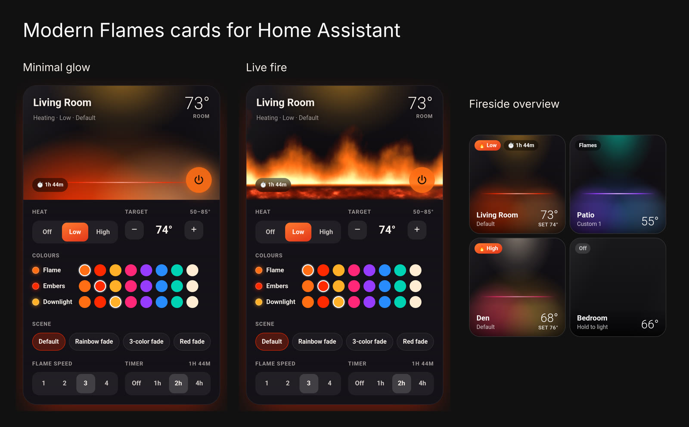
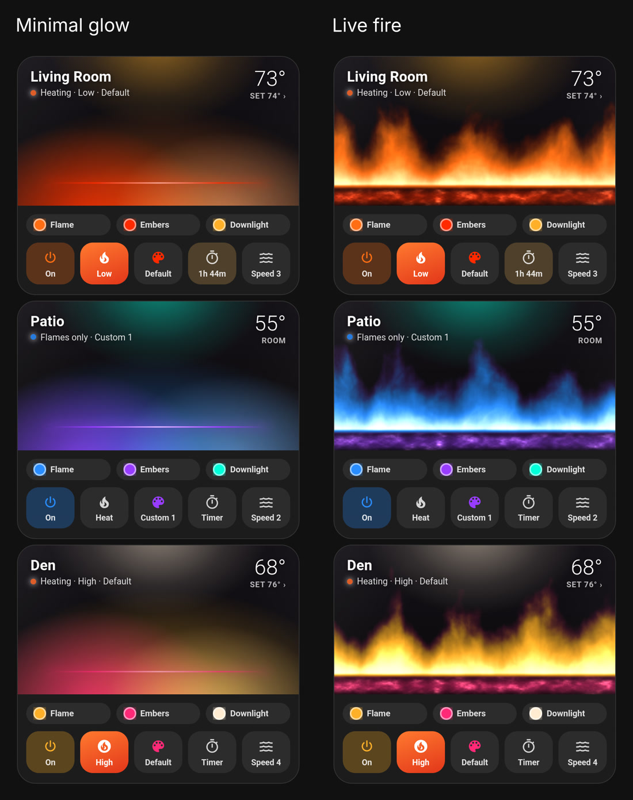

# Modern Flames Wi-Fi fireplaces in Home Assistant, fully local



Modern Flames' Wi-Fi fireplaces run on Tuya hardware, so Home Assistant can control them on your own network with [tuya-local](https://github.com/make-all/tuya-local): power, the heater, all three colour zones, scenes, flame speed and the off timer, with no cloud in the loop once it's set up. This guide takes one fireplace from the Modern Flames app to a working Home Assistant device in about an hour. Repeat the fireplace steps for each unit.

**Works with:** Modern Flames **Landscape Pro Slim** and **PRO V2** units sold as *"W/Wi-Fi & Bluetooth LE"* (Tuya product id `v4r5dzjgkhnagnqc`). Other models may work if tuya-local recognises them; the steps are the same.

> Not affiliated with Modern Flames or Tuya. You're re-pairing your fireplace and controlling a heater: read [what you give up](#what-you-give-up) first, and never leave the heater running unattended.

**Steps:** [Before you start](#before-you-start) · [1. Move to Smart Life](#1-move-the-fireplace-to-smart-life) · [2. Tuya developer project](#2-create-a-tuya-developer-project) · [3. Get the local key](#3-get-the-local-key) · [4. Add it to Home Assistant](#4-add-it-to-home-assistant) · [Entities](#what-you-get) · [Tips](#tips) · [Troubleshooting](#troubleshooting) · [Automations](#example-automations) · [Dashboard cards](#dashboard-cards)

## Before you start

- Home Assistant with **[HACS](https://hacs.xyz/)** installed.
- The fireplace on your **2.4 GHz** Wi-Fi and working in the Modern Flames app.
- A phone with the **Smart Life** app (*"Smart Life - Smart Living"*, by Volcano Technology / Tuya). Create an account in the same country you use today.
- A free **Tuya developer account** at [platform.tuya.com](https://platform.tuya.com), or Python 3 if you want to fetch keys with tinytuya (step 3 covers both).
- Access to your router, to give each fireplace a fixed IP address.
- About an hour, most of it for the first fireplace.

**Why the move to Smart Life?** The Modern Flames app is a white-label Tuya app. Tuya only lets you link the official **Smart Life** (or Tuya Smart) app account to a developer project, and that link is how you get the fireplace's local key. Scanning the developer QR code with the Modern Flames app just says the code has **expired**.

## 1. Move the fireplace to Smart Life

1. **Remove it from the Modern Flames app.** Open the fireplace in the app → the pencil or ⋯ menu → **Remove device**. When asked, choose **Disconnect and wipe data** (remove and clear data), so the fireplace forgets its old pairing.
2. **Put the fireplace in pairing mode.** With the fireplace **on**, press and hold **Preset Color** on the fireplace's control panel for **3 seconds**, until the lights **flash white quickly**. That's EZ pairing mode. (Holding about 6 seconds gives a slow flash, AP mode, which Smart Life also supports.)
3. **Add it in Smart Life.** Smart Life → **+** → **Add Device**. Allow Bluetooth and location, and let it find the fireplace automatically, or pick it by category. Enter your **2.4 GHz** Wi-Fi password. It may show up with a generic name such as *"PRO V2 W/Wi-Fi & Bluetooth LE"*.
4. **Check it works.** In Smart Life, turn it on and off and change a colour. Give it a clear name, such as *Living Room Fireplace*; Home Assistant uses this name later.

## 2. Create a Tuya developer project

You only need this to read the local key. Home Assistant never uses the Tuya cloud afterwards.

1. Sign in at [platform.tuya.com](https://platform.tuya.com) → **Cloud** → **Development** → **Create Cloud Project**.
   - Name: anything, e.g. *Home Fireplaces*
   - Industry: **Smart Home** · Development method: **Smart Home**
   - Data center: **Western America** for US accounts. It must match your Smart Life account's region; see [Troubleshooting](#troubleshooting).
2. On the API services screen, keep **IoT Core** and **Authorization Token Management** selected → **Authorize**.
3. Open the project → **Devices** → **Link App Account** (Link Tuya App Account) → **Add App Account**. A QR code appears.
4. In **Smart Life**: **Me** → the scan icon at the top right → scan the QR code → **Confirm login**.
5. Choose **Automatic Link** as the device linking method and confirm. Your fireplace appears under **Devices → All Devices**.
6. Note the project's **Access ID** and **Access Secret** from the **Overview** tab. Treat them like passwords.

The IoT Core service starts as a free one-month trial. That's plenty; if it lapses, use **Extend trial period** in the project.

## 3. Get the local key

Each fireplace needs three things: its **device ID**, its **local key** and its **IP address**. Pick one way.

### Option A: tinytuya wizard

```bash
python3 -m venv tuya && . tuya/bin/activate
pip install tinytuya
python -m tinytuya wizard
```

- Enter the **Access ID** (API key) and **Access Secret** from step 2, region **us**, and one device ID (from the Devices tab) when asked.
- Answer **Yes** to polling and scanning. The wizard writes `devices.json` with each device's `id`, `key`, `ip` and `version`.
- Keep `devices.json` private: anyone with the key can control the fireplace on your network.
- `python -m tinytuya scan` lists the fireplaces it can see on your network, with IP and protocol version (expect **3.3**).

### Option B: tuya-local's cloud login

tuya-local can fetch the key itself. In step 4 choose the **cloud-assisted** setup, enter the **User code** from Smart Life (**Me** → ⚙ **Settings** → **Account and Security** → **User Code**), and scan the QR code it shows with Smart Life. Pick the fireplace from the list and tuya-local fills in the ID and key. You can skip the developer project in step 2 with this option.

## 4. Add it to Home Assistant

1. **Install tuya-local.** HACS → search **Tuya Local**. If it isn't listed, HACS → ⋮ → **Custom repositories** → `https://github.com/make-all/tuya-local`, type **Integration**. Download it and **restart** Home Assistant. Use release **2026.8.1 or newer**, which includes the Landscape Pro Slim profile.
2. **Give the fireplace a fixed IP.** In your router, reserve the fireplace's current address (DHCP reservation).
3. **Settings → Devices & services → Add integration → Tuya Local.** Choose **manual** setup (or cloud-assisted, see option B) and fill in:

   | Field | Value |
   | --- | --- |
   | Device ID | `<DEVICE_ID>` |
   | Host | `<FIREPLACE_IP>` |
   | Local key | `<LOCAL_KEY>` |
   | Protocol version | **3.3** |

4. When tuya-local lists matching device types, pick **Modern Flames Landscape Pro Slim** (the profile's own name is *Fireplace*).
5. Name it, e.g. *Living Room Fireplace*. That gives entity IDs like `climate.living_room_fireplace`.
6. Test it: turn the flames on and off, change a colour, then try the heater while you're in the room.

Repeat steps 1–4 for each fireplace.

## What you get

For a fireplace named *Living Room Fireplace* (`<prefix>` = `living_room_fireplace`):

| Entity | What it does |
| --- | --- |
| `climate.<prefix>` | Power and heater. `off`, `fan_only` (flames only) or `heat`. Fan mode `off` / `low` / `high` sets the heater. Room temperature, and a target (50–85 °F) while heating. |
| `light.<prefix>_flame` | Flame colour and brightness (RGB) |
| `light.<prefix>_embers` | Ember bed colour and brightness (RGB) |
| `light.<prefix>_downlight` | Downlight colour and brightness (RGB) |
| `select.<prefix>_scene` | 11 scenes: Default, Rainbow / 3-color / Red / Green / Blue fade, Rainbow / 3-color jump, Custom 1–3 |
| `select.<prefix>_flame_motor_speed` | Flame speed 1–4 |
| `select.<prefix>_timer` | Off timer: cancel, 30 minutes, 1–8 hours |
| `select.<prefix>_temperature_unit` | Celsius or Fahrenheit, as the fireplace reports it |
| `sensor.<prefix>_time_remaining` | Minutes left on the timer |
| `switch.<prefix>_sync_lights` | Change all three colour zones together |
| `text.<prefix>_custom_scene_*`, `…_schedule` | Custom scene and schedule data in packed formats. Disabled by default; leave them off. |

The power switch is shared: turning the climate `off` switches the whole unit off, lights included.

## Tips

- **Temperatures look off?** Set `select.<prefix>_temperature_unit` to **fahrenheit** (or celsius) to match Home Assistant, so the room and target temperatures line up.
- **Reserve the IP** of every fireplace in your router. tuya-local connects by address.
- **One local connection per device.** Tuya devices accept only one local connection at a time. Close tinytuya and other local tools while Home Assistant is connected. If control is flaky, close the Smart Life app on phones on the same Wi-Fi.
- **Re-pairing changes the key.** If you ever reset or re-add a fireplace in Smart Life, fetch the new local key and update it in tuya-local (**Configure** on the device).
- Your remote control and the fireplace's own panel keep working alongside Home Assistant.

## Troubleshooting

| Problem | Fix |
| --- | --- |
| The QR code says **expired** | You scanned it with the Modern Flames app. Move the fireplace to Smart Life (step 1) and scan with Smart Life. |
| **No devices** in the Tuya project after linking | The project's data center doesn't match your account. Switch the data center at the top right of the Devices page; US accounts are **Western America**. |
| tuya-local can't connect | Check the IP and the local key (it changes after re-pairing), try protocol **3.3**, close other local tools, and make sure Home Assistant can reach the fireplace on TCP port 6668 (same network or VLAN rules). |
| The device type isn't offered | Update tuya-local to 2026.8.1 or newer. Check the product id is `v4r5dzjgkhnagnqc` in tinytuya's output. |
| Entities go unavailable now and then | Weak Wi-Fi or a changing IP. Reserve the IP and check the signal near the fireplace. |
| The heater doesn't start | Heat is the climate **fan mode** (`low` / `high`), not just `hvac_mode: heat`. |
| Temperatures are wrong | Set the temperature unit; see [Tips](#tips). |

## What you give up

- **The Modern Flames app.** The fireplace now lives in Smart Life, which may show a generic control panel.
- **My Ambience scenes** you saved in the Modern Flames app. The fireplace's built-in scenes and Custom 1–3 still work.
- **The Modern Flames Alexa skill.** Link the **Smart Life** skill instead, or expose the fireplace to Alexa or Google from Home Assistant.

## Example automations

These are **examples**: check the entity IDs and option names under **Developer tools → States** before using them, and test them while you're home. Don't automate the heater to run while nobody is around.

**Bedtime off timer.** At 10:30 pm, if the fireplace is on, set a one-hour off timer.

```yaml
alias: Fireplace bedtime timer
triggers:
  - trigger: time
    at: "22:30:00"
conditions:
  - condition: not
    conditions:
      - condition: state
        entity_id: climate.living_room_fireplace
        state: "off"
actions:
  - action: select.select_option
    target:
      entity_id: select.living_room_fireplace_timer
    data:
      option: 1h
mode: single
```

**Flames only at sunset.** Turn on the flames (no heat) in warm colours at sunset.

```yaml
alias: Fireplace flames at sunset
triggers:
  - trigger: sun
    event: sunset
actions:
  - action: climate.set_hvac_mode
    target:
      entity_id: climate.living_room_fireplace
    data:
      hvac_mode: fan_only
  - action: light.turn_on
    target:
      entity_id: light.living_room_fireplace_flame
    data:
      rgb_color: [255, 110, 20]
      brightness_pct: 80
  - action: light.turn_on
    target:
      entity_id: light.living_room_fireplace_embers
    data:
      rgb_color: [255, 42, 0]
mode: single
```

**Heat off when everyone leaves.** A safety net for the heater.

```yaml
alias: Fireplace heat off when away
triggers:
  - trigger: state
    entity_id: zone.home
    to: "0"
actions:
  - action: climate.set_fan_mode
    target:
      entity_id: climate.living_room_fireplace
    data:
      fan_mode: "off"
mode: single
```

## Dashboard cards



Once your fireplace is in Home Assistant, the **[Modern Flames cards](../README.md)** give it a dashboard that glows in the fireplace's real colours. Pick the **minimal glow**, a calm gradient in your flame and ember colours, or **live fire**, a real-time flame that follows your colours and flame speed. There's a hero card, a slim chip row, an overview grid tile and an all-in-one Studio card, and they work with the entity names above out of the box.

## Credits

- [tuya-local](https://github.com/make-all/tuya-local) by make-all and contributors, and the Landscape Pro Slim device profile from [PR #5739](https://github.com/make-all/tuya-local/pull/5739).
- [tinytuya](https://github.com/jasonacox/tinytuya) by Jason Cox and contributors.

Shared under the [MIT License](https://opensource.org/license/mit). Modern Flames is a trademark of its owner; this guide isn't affiliated with or endorsed by Modern Flames or Tuya.
